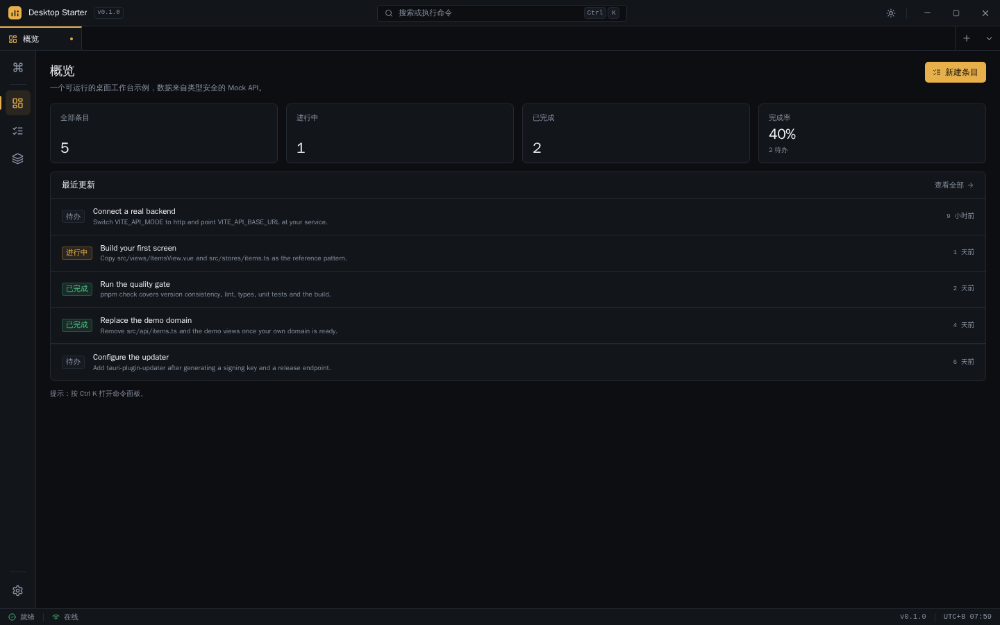
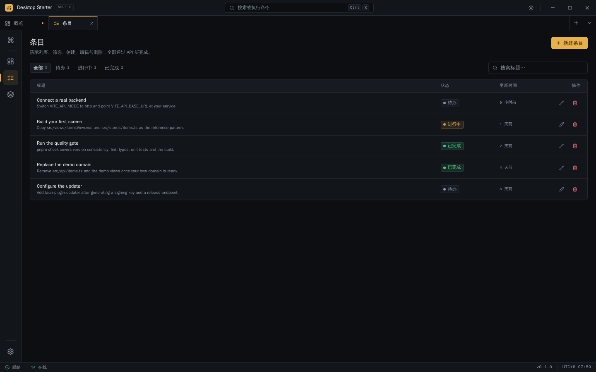

# Desktop Starter

一个可运行的 Tauri 2 + Vue 3 桌面应用起手模板：无边框工作台外壳、多标签、命令面板、设置页、类型安全的 API 层（内置 Mock 后端），以及一条命令即可跑通的质量门禁。

<!-- template:start -->
## 用这个模板创建新项目

```sh
# 1. 复制模板（不要复制 node_modules / dist）
cp -r client-app/template ~/Projects/my-app
cd ~/Projects/my-app

# 2. 重命名应用、包名、bundle identifier 与 deep-link scheme
pnpm run init                 # 交互式
pnpm run init --name "My App" --identifier com.acme.myapp --scheme myapp --yes

# 3. 安装并运行
pnpm install
pnpm dev                      # 浏览器预览 http://localhost:1420
pnpm tauri dev                # 原生窗口
```

`scripts/init.mjs` 会自动改写 `package.json`、`src/config/app.ts`、`src-tauri/tauri.conf.json`、`src-tauri/Cargo.toml`、`src-tauri/src/{main,lib}.rs`、`index.html`、`README.md` 与 `LICENSE`，并把 localStorage 前缀换成新的包名。

> 模板默认不含 updater 与代码签名：它们依赖你自己的密钥和发布基础设施，需要时再接入（见文末）。
<!-- template:end -->

## 预览





## 包含什么

| 能力 | 位置 |
| --- | --- |
| 无边框窗口 + 自定义标题栏 / 拖拽区 / 窗口控制 | `src/components/shell/TitleBar.vue`、`src-tauri/tauri.conf.json` |
| 多标签页（可关闭、持久化、新窗口打开） | `src/components/shell/TabStrip.vue`、`src/stores/tabs.ts` |
| 活动栏、状态栏、命令面板（`Ctrl/⌘ + K`） | `src/components/shell/` |
| 深色 / 浅色 / 跟随系统 + 紧凑 / 舒适密度 | `src/stores/settings.ts`、`src/assets/main.css` |
| 中英双语（键值字典，切换即时生效） | `src/i18n/` |
| 弹窗 / 抽屉 / 菜单 / Toast / 图表组件 | `src/components/ui/`、`src/views/UiKitView.vue` |
| 类型安全 API：contracts → client → transport | `src/api/` |
| Mock 后端（可持久化、可加路由）与 HTTP 传输 | `src/api/mock.ts`、`src/api/http.ts` |
| 示例业务：条目 CRUD（列表 / 筛选 / 新建 / 编辑 / 删除） | `src/api/items.ts`、`src/stores/items.ts`、`src/views/ItemsView.vue` |
| Tauri 命令：平台信息、导出文件、新窗口 | `src-tauri/src/lib.rs` |
| 托盘、deep link、开机自启、全局快捷键、日志（原生应用菜单仅 macOS） | `src-tauri/src/lib.rs`、`src/lib/desktop.ts` |
| 单测 + E2E + lint + 类型检查 | `src/**/__tests__`、`e2e/`、`pnpm check` |

## 开发

```sh
pnpm install
pnpm dev          # 浏览器预览（窗口按钮与拖拽不生效，其余功能可用）
pnpm tauri dev    # 原生窗口
pnpm check        # version → lint → type-check → test → build
pnpm test:e2e     # Playwright
```

Linux 需要 WebKitGTK 依赖：

```sh
# Arch
sudo pacman -S webkit2gtk-4.1 base-devel curl wget file openssl libappindicator-gtk3 librsvg
# Ubuntu / Debian
sudo apt install libwebkit2gtk-4.1-dev build-essential curl wget file libssl-dev \
  libayatana-appindicator3-dev librsvg2-dev
```

## 分层约定

| 目录 | 职责 |
| --- | --- |
| `src/views/` | 路由页面：只做 store 读取、路由编排与子组件组合 |
| `src/components/shell/` | 桌面外壳：标题栏、标签页、活动栏、状态栏、命令面板、Toast |
| `src/components/ui/` | 无业务依赖的展示组件；不 import store / router / Tauri |
| `src/components/<feature>/` | 领域组件（示例：`items/`） |
| `src/stores/` | Pinia 状态与动作 |
| `src/composables/` | 窗口、时钟、网络、快捷键、弹窗焦点等响应式逻辑 |
| `src/lib/` | 纯函数与适配层（格式化、平台判断、外链、桌面桥接） |
| `src/api/` | 契约、客户端、Mock/HTTP 传输、领域接口 |

约定：

- 展示组件通过 `props` 接收数据、`emits` 通知父级，不直接修改 props。
- `components/ui` 不依赖 store / router / Tauri。
- 所有 Tauri 调用集中在 `composables/` 与 `lib/`，组件不直接 `invoke`。
- 纯函数优先补 Vitest 测试。

## API 层

默认 `VITE_API_MODE=mock`，数据保存在内存并持久化到 localStorage。切到真实后端：

```sh
VITE_API_MODE=http
VITE_API_BASE_URL=https://api.example.com/v1
```

`src/api/index.ts` 按环境变量选择 transport，store 与页面无需修改。新增领域资源时，按 `src/api/items.ts` 的模式：DTO → mock 路由 → endpoint 工厂。

## 定制清单

- [ ] 应用名 / identifier / scheme：`pnpm init`（或手动改 `src/config/app.ts` 与 `src-tauri/tauri.conf.json`）
- [ ] 图标：替换 `src-tauri/icons/`、`public/favicon.svg`（`pnpm tauri icon path/to/icon.png`）
- [ ] 主题色：`src/assets/main.css` 顶部的 `--accent` 等令牌
- [ ] Mock 种子数据：`src/api/items.ts` 的 `seedItems`
- [ ] 移除示例资源：删除 `src/api/items.ts`、`src/stores/items.ts`、`src/views/{Home,Items}View.vue` 及路由
- [ ] CI：把 `pnpm check` 接进 Gitea Actions / GitHub Actions
- [ ] 发布：Tauri 打包、updater、代码签名

### 接入 updater（可选）

```sh
pnpm tauri signer generate -w ~/.tauri/myapp.key
```

然后添加 `tauri-plugin-updater` 与 `tauri-plugin-process`，在 `tauri.conf.json` 的 `plugins.updater` 写入 `pubkey` 与 `endpoints`，并在 `capabilities/default.json` 加上 `updater:default`、`process:default`。

## 目录

```text
src/
├── api/            contracts / client / http / mock / items
├── assets/main.css 设计令牌与基础样式
├── components/
│   ├── shell/      标题栏、标签页、活动栏、状态栏、命令面板、Toast
│   ├── ui/         dialog/ 与通用展示组件
│   ├── ui-kit/     组件预览卡片
│   └── items/      示例领域组件
├── composables/    窗口、时钟、网络、平台信息、快捷键、弹窗焦点
├── config/app.ts   应用名、版本、存储前缀、deep-link scheme
├── i18n/           zh-CN / en-US 字典
├── layouts/        WorkbenchLayout
├── lib/            格式化、平台、外链、桌面桥接、图标、状态
├── router/
├── stores/         settings / tabs / ui / items
└── views/          Home / Items / Settings / UiKit
```

## License

[MIT](LICENSE)
